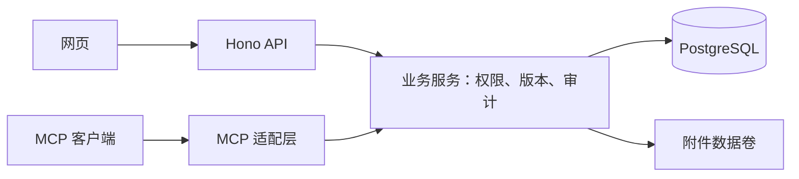

# YuanPlan 项目管理软件：V1 产品与技术设计

日期：2026-09-17\
状态：供集中审阅的设计基线；已确认方向与建议默认值分开列示，当前未开始应用代码实现。\
工作名称：YuanPlan，沿用目录名，尚未确定正式品牌。

关联文档：
- [讨论决策记录](./2026-09-17-product-discovery.md)
- [UI 组件与样式约束](./2026-09-17-ui-direction.md)
- [分阶段开发任务](./2026-09-17-development-tasks.md)

## 1. 产品目标与边界

为个人和小团队提供简单、流畅、容易部署的项目协作工具。以项目为权限边界，把任务、文档与 AI 接口放在同一套业务规则下。

### 1.1 已确认方向

1. 独立开发，参考 Kaneo、Plane 的简洁体验，自行实现代码与产品设计。
2. 项目独立，团队可选，不设置工作空间层级。
3. 项目有管理员、成员、只读三种固定角色，团队权限不自动继承到项目。
4. 任务固定四态：待办、进行中、待验收、已完成；允许任意方向流转，无强制审批。
5. 每个任务最多一个执行人，可未分配；创建者单独记录。支持一层子任务。
6. 项目 Wiki 使用轻量富文本，提供目录、自动保存、历史版本、任务链接及编辑冲突提示。
7. 任务和 Wiki 每次成功保存必须记录操作者和具体变动，历史长期保留，不自动清理。
8. MCP 提供日常任务与文档读写，共用项目权限、版本检查和审计规则。
9. 全栈 TypeScript；React、Vite、Mantine；Node.js、Hono；PostgreSQL、Drizzle；Tiptap。
10. 模块化单体，一个应用容器加数据库，附件使用本地持久化目录。

### 1.2 首版范围

账号及邀请、项目及成员、可选团队、任务列表与固定看板、基础筛选、单执行人、一层子任务、评论与附件、项目 Wiki、版本和审计、MCP、备份恢复、升级迁移。

### 1.3 首版不做

自定义列和工作流、审批引擎、复杂角色配置、多层子任务、任务依赖、工时与计费、甘特图、实时共同编辑、原生移动应用、企业 SSO、第三方业务集成、内置 Agent 执行平台、支付订阅系统。商业销售不等于首版必须内建计费。

## 2. 建议默认值与待定事项

以下为完成可执行计划所提出的默认值，不冒充已确认需求。实施对应功能前按审阅反馈修订。

| 编号 | 建议默认值 | 原因或影响 |
|---|---|---|
| D01 | 中文界面，浅色主题首发，桌面优先并提供窄屏基本操作 | 先统一一种完整体验；暗色和英文另排迭代 |
| D02 | 一个项目最多关联一个团队，允许不关联 | 足够表达原始需求；直接邀请仍可跨团队协作 |
| D03 | 团队成员能查看本团队人员名单，团队管理员维护名单；关联与选人要求操作者同时有项目管理权和该团队访问权 | 避免通过项目选人泄露私有团队信息 |
| D04 | 邀请 7 天有效；公开注册要求配置邮件并验证邮箱 | 限制冒用邮箱；未配置邮件时使用仅邀请模式 |
| D05 | 单附件默认 20MB，可由实例管理员配置上限；默认存本地数据卷 | 控制小实例的存储与上传负载 |
| D06 | Wiki 页面树最多 5 层；标题必填，正文可空 | 满足项目文档组织，避免复杂无限层级界面 |
| D07 | Wiki 输入停止约 2 秒后自动保存；保存中排队后续内容，失败时保留本地草稿 | 降低保存频率，但每次实际保存仍完整留痕 |
| D08 | 任务、文档和项目采用软删除；首版不提供永久删除；管理员可恢复 | 保留追溯依据，与长期历史要求一致 |
| D09 | 项目归档后只读；任务可单独归档以移出日常列表，状态不因此变化 | 归档和完成是不同概念；不新增第五种任务状态 |
| D10 | 首版不单独增加“取消”状态或标记；不再需要的任务由管理员归档或软删除 | 保持四态简单；如需取消原因可在归档记录填写 |
| D11 | 看板显示父任务和独立任务，卡片显示子任务进度；子任务在详情与可展开列表显示 | 避免父子重复占满看板；“我的任务”和搜索可找到子任务 |
| D12 | 评论首版只支持新增，暂不支持编辑；管理员可软删除并保留内容历史 | 简化多人讨论的追溯规则 |
| D13 | Wiki 旧版本可由管理员或成员恢复为新版本；任务首版提供历史查询，字段修正通过普通编辑完成 | 符合协作编辑权限，控制恢复功能范围 |
| D14 | 两种客户端实际验证的 MCP 接入方式作为发布范围；不宣称兼容所有客户端 | HTTP 认证支持因客户端而异，必须实测 |

仍待产品决策：正式名称、最终开源许可证、首发浏览器及 MCP 客户端范围。许可证未决定前，不对外发布带有猜测许可证的产品代码。

## 3. 页面与 UI

### 3.1 导航与页面

- 登录、注册、接受邀请、密码恢复、首次安装初始化。
- 我的项目：可访问项目列表，创建、搜索、归档筛选。
- 我的任务：跨可访问项目的本人执行任务，显示父任务上下文。
- 团队：本人可访问团队、成员、邀请和团队设置。
- 项目：任务、文档、成员、设置四个入口；按角色展示可执行动作。
- 任务：列表/看板切换、筛选栏、创建入口、任务详情抽屉及独立链接。
- 文档：目录树、编辑/只读正文、保存状态、版本历史和关联任务。
- 个人设置：账号、密码、MCP 凭据。
- 实例设置：注册策略、邮件、账号启停、运行信息；仅系统管理员访问。

### 3.2 一致性约束

Mantine 为唯一通用 UI 系统，主题集中定义，业务布局使用 CSS Modules。不另行加入另一套按钮、表单和弹窗系统。先完成组件样板页，再展开业务页面。

状态、优先级、成员选择器、任务卡片、详情布局、筛选栏、空状态、错误状态和保存反馈统一复用。使用一套图标；图标按钮有可访问名称，状态同时显示文字。沿用并验证组件库键盘及焦点管理。

窄屏提供列表和状态选择器，不能把拖拽作为唯一移动任务的入口。富文本与历史差异等较重能力按页面加载。界面方案不使用 Kaneo 或 Plane 的代码、品牌素材或产品文案。

## 4. 账号、邀请与协作模型

### 4.1 身份

优先评估 Better Auth 的邮箱密码、会话和恢复能力，通过 Hono 及 Drizzle 集成；不自行实现密码算法。该组件属于建议实施选型，须先验证当前稳定版本、迁移兼容性及许可。

网页会话使用安全 Cookie 与服务端会话记录；每次请求检查账号是否停用。系统管理员不获得绕过项目权限的应用接口，但其账号恢复能力属于高信任运维权限，不能宣传为对实例运营方的密码学隔离。

首次初始化要求安装端提供一次性设置凭据，初始化完成立即关闭；并发初始化只能产生一次成功结果。禁止公开实例上任何匿名访问者抢占首个管理员。

账号停用后会话和 MCP 凭据失效；保留稳定用户 ID 和历史显示名。常规管理不物理删除历史身份。

### 4.2 邀请与验证

邀请包含目标项目或团队、邮箱、角色、邀请人、失效时间、状态及令牌摘要，数据库不存邀请令牌明文。接受邀请须校验目标、账号、邮箱、有效期和权限，并原子消费令牌；不能通过篡改参数更换角色或目标。

有邮件时通过邮件验证邮箱。没有邮件时，管理员自行将绑定邮箱的一次性邀请交付给预期接收人；记录其身份建立方式为管理员邀请，不把它伪称为已通过邮箱验证。单凭输入相同邮箱不能取得成员资格。已有未验证账号占用邮箱时不得自动合并或授权，进入受控验证/恢复流程。

邀请创建时与接受时均检查邀请人的目标管理资格；角色已变更、邀请被撤销、项目归档/删除或账号停用时拒绝无效邀请。重复接受同一邀请不产生重复成员。

密码恢复：有邮件时使用短期一次性找回流程；无邮件时由系统管理员核实身份后签发短期一次性恢复链接，用户自行设置新密码，管理员不查看密码。恢复及凭据撤销留实例管理记录。实例管理员本人失联时提供需要主机访问权的离线恢复工具，并记录恢复事件。

### 4.3 项目与团队

用户直接创建项目并成为项目管理员。项目关联团队只是组织信息，真正授权以 project_members 为准。从团队批量加入人员，逐一创建项目成员记录，后续不动态同步团队名单。

移除团队成员时仅向操作者展示其有权访问的相关项目。项目移除动作逐项目检查管理权，不得借团队权限批量越权。删除团队解除关联，保留项目。

移除项目成员后，其新请求立即失去该项目权限。建议将其未归档且未删除任务的执行人清空，由管理员重新分配；每项变更记录发起管理员、原执行人及移除原因。历史版本仍保留原身份。此处理属于待审阅的细节。

任何正常角色操作都不能移除或降级最后一名项目管理员。停用账号涉及最后管理员时，先要求完成项目管理权交接，不能造成无人管理项目。

### 4.4 项目权限矩阵

| 操作 | 管理员 | 成员 | 只读 |
|---|---|---|---|
| 查看项目、任务、文档、附件和历史 | 是 | 是 | 是 |
| 新建/编辑任务与子任务，调整状态与执行人 | 是 | 是 | 否 |
| 新建/编辑文档及恢复文档内容版本 | 是 | 是 | 否 |
| 添加评论与附件 | 是 | 是 | 否 |
| 删除任务/文档，恢复删除项，管理归档 | 是 | 否 | 否 |
| 邀请/移除成员、修改角色 | 是 | 否 | 否 |
| 项目设置、项目归档/删除 | 是 | 否 | 否 |
| 修改/删除历史记录 | 否 | 否 | 否 |

权限必须落在后端业务服务。列表、搜索、附件、历史、导出和 MCP 都检查同一边界；前端隐藏按钮不构成授权。关联资源必须属于同一项目。

## 5. 任务、子任务与附件

### 5.1 字段与行为

字段：标题、富文本描述、固定状态、单执行人、优先级、标签、开始日期、截止日期、附件。标题必填；状态默认待办，优先级默认普通，其他可选。创建者、创建时间、更新时间和稳定 ID 自动记录；项目内生成递增任务编号，不因删除复用旧编号。

状态映射：todo=待办、in_progress=进行中、in_review=待验收、done=已完成。所有四态之间都可切换，沿用正常编辑权限。任务进入完成时记录完成时间，重新打开时清空当前完成时间，历史变化不丢失。

开始/截止日期按日期存储；开始日期不得晚于截止日期。审计时间使用服务端 UTC，界面按用户时区显示。首版没有单独取消状态。

项目标签可由管理员或成员创建和改名；删除标签及批量解除关系只由管理员执行，并保留受影响任务的变更记录。跨项目引用标签、执行人或父任务必须被拒绝。

### 5.2 子任务与看板

子任务与父任务必须同项目，层级最多一层，不能循环；子任务独立拥有上述字段。父任务完成进度按未删除子任务计算，已归档但未删除的子任务仍计入，父任务状态不自动变化。进度不代表强制验收条件。

首版不提供跨项目移动、批量更换父级或任意层级重组。建议父任务删除时同时软删除未删除子任务，分别记录事件并使用批次 ID 关联；恢复该批次只恢复当时一起删除的子任务，不恢复此前独立删除的内容。

看板顺序按项目、状态及排序键保存；拖动涉及状态或用户可见顺序变化时留下记录。并发移动校验受影响版本；排序键的内部重排不伪造为其他任务内容被用户修改。

### 5.3 评论与附件

评论记录作者和创建时间，通过项目角色允许新增；删除评论保留原内容与删除事件。首版不实现评论编辑，以免引入另一套编辑冲突界面。

附件元数据带 project_id、资源 ID、上传人、原名称、实际大小、类型、校验值及不可变存储键。不得覆盖同一存储键的历史文件；替换是新附件。下载与预览均检查项目和资源权限，不把附件目录作为公开静态目录暴露。

上传先写临时区，完成类型/大小验证及持久文件落盘后，在数据库事务内绑定业务资源、生成资源版本与审计。绑定失败可能留下孤立文件，由维护任务安全清理；不能让成功版本引用未持久化文件。文件与数据库不宣称存在跨系统原子事务。

文本、链接及文件预览需要防止脚本注入、路径穿越和危险内容执行。禁止服务端无约束抓取用户提供的远程 URL；首版使用主动上传图片。

## 6. Wiki 与历史追溯

### 6.1 文档模型

文档按项目组织目录树，同项目父子关联，禁止循环。文档标题、正文、目录位置变化都记录操作者。建议非空目录页删除前先移动或删除子页，首版不隐式递归删除整棵文档树。

正文以有 schema_version 的 Tiptap JSON 为权威数据，提取纯文本用于搜索。网页及 MCP 均经同一校验器生成合法文档树。HTML 仅用于受控渲染，不作为另一份可独立修改的权威正文。

任务链接使用项目内稳定资源 ID，建立可查询的反向关联；禁止通过链接解析泄露不可访问项目标题。历史内容中的失效链接可显示不可用，不删除历史。

### 6.2 每次保存的精确定义

每个新接受且成功提交的保存请求产生一条保存记录。显式提交相同内容也记录一次无内容变化的保存；编辑器没有变化时不自动发请求。网络重试使用相同幂等键，返回原结果，不重复生成逻辑保存。

首版建议任务和文档每次保存保留完整规范化快照，字段差异另作摘要；更容易验证任一版本可还原。先通过延迟自动保存、数据库压缩及分页控制开销。差异链与历史归档属于后续优化，必须在回放验证通过后采用，不能通过删历史节省空间。

以下也计入变更：状态、执行人、优先级、标签、日期、描述、标题、目录/排序、附件关系、软删除、恢复与归档。评论独立记录自身事件，并可在任务时间线查看；不必为每条评论复制完整任务正文。

### 6.3 保存链路与并发

1. 服务端从会话或 MCP 凭据解析真实认证主体，忽略客户端传入的修改人。
2. 校验当前账号、项目权限、凭据范围和资源归属，确认资源允许写入。
3. 请求携带 expected_version 与幂等键，规范化并校验内容。
4. 数据库事务内锁定必要记录或以条件更新完成版本校验，更新资源，插入版本和审计事件；约束防止版本号重复。
5. 一并提交后返回新版本号和审计标识。任何一项失败则整体回滚。

版本不符返回 VERSION_CONFLICT，不能用最后写入覆盖。前端保留本地草稿，展示服务器新版本并允许比较后重新编辑；不提供绕过校验的静默强制覆盖。MCP 返回结构化冲突，让客户端重新读取再提交。

请求已提交但网络响应丢失时，通过幂等键查询/重试取得原结果。去重信息至少覆盖接口公布的重试期限，关键写入记录关联的操作 ID 长期保留，以便查证。

### 6.4 审计字段及不可修改边界

审计记录包含 event_id、project_id、resource_type、resource_id、operation、before_version、after_version、actor_user_id、操作时显示名、source(web/mcp/system)、credential_id、request_id、operation_id、server_time、change_summary 与可关联的版本数据。

不保存密码、会话令牌、API Key 明文。客户端名称只能作辅助信息，不能当作可信的人类身份。系统自动操作记录 system 主体、规则原因及触发人（若有），不能伪装为执行人主动修改。

应用数据库运行角色对版本/审计表仅具备必要 SELECT、INSERT 权限，迁移使用独立高权限身份。软删除不级联删除历史。产品不存在历史编辑/删除接口。此边界不防御拥有数据库或主机管理权限的人；首版不承诺外部存证或密码学防篡改。

历史默认长期保留；列表分页查询，正文按需读取。恢复 Wiki 旧版本时校验当前权限与版本，产生新的内容版本和恢复事件，不覆盖旧记录，不默认复原历史目录/权限。历史附件也必须能通过授权访问，不能被孤立文件清理误删。

## 7. MCP 与 API

### 7.1 业务工具建议契约

| 工具组 | 建议工具 | 规则 |
|---|---|---|
| 项目读取 | list_projects, get_project, list_project_members | 只返回身份和凭据均允许的项目 |
| 任务 | list_tasks, get_task, create_task, update_task | update 包含状态/执行人变更，必须带 expected_version |
| 子任务 | list_subtasks, create_subtask | 更新复用 update_task，强制同项目及一层 |
| 评论 | list_comments, add_comment | 新增支持幂等键，不提供编辑/删除 |
| 文档 | search_documents, get_document, create_document, update_document | Markdown 读写，更新检查版本和可转换内容 |
| 历史 | list_task_history, list_document_versions, get_document_version | 分页、可授权地读取历史内容 |

搜索任务可通过 list_tasks 的 query 参数实现；Wiki 目录通过文档查询返回 parent_id 与分页结果。项目创建、成员管理、角色修改、资源删除、归档和版本恢复首版没有 MCP 工具。

每个工具有稳定名称、参数 schema、错误码、长度限制、分页和最大返回数量。把统一业务错误映射为 MCP 工具错误；不能只返回 HTTP 状态。新增工具之前必须定义权限及审计验收。

### 7.2 凭据及接入

用户创建绑定本人身份的凭据，显式选择已有项目及只读/读写范围，可设置有效期并随时撤销。明文只展示一次，服务端存高熵令牌的安全摘要及识别前缀。持有只读项目角色的用户不能通过创建读写凭据扩大权限。

每个请求按当前身份、当前项目角色和凭据范围授权；不能在连接建立时检查一次后永久信任。撤销/移除提交后的新请求必须拒绝，不能使用过期权限缓存。已在提交边界中的请求通过事务顺序明确定义行为，并留可解释记录。

建议服务端以官方 SDK 提供 Streamable HTTP；对支持显式认证头的客户端采用预配置用户凭据。该模式不等于完整 MCP OAuth 授权实现。必须在早期验证客户端兼容性；若首发客户端不支持该方式，使用轻量 stdio 桥接客户端或按协议实现所需 OAuth 资源发现与授权，更新任务范围。桥接仅转发，不复制业务或权限实现。首版是否交付桥接由兼容验证结果决定。

网络服务校验 Origin 与允许的 Host，生产使用 HTTPS。凭据通过安全配置/环境传递，不写进日志或示例仓库，不接受任意客户端 actor 参数作为审计身份。

### 7.3 Markdown 转换

明确支持标题、段落、列表、任务列表、代码块、普通链接、图片和基础表格。内部任务链接使用普通链接表示，按资源 ID 解析。

get_document 返回正文、version、format 及可转换能力提示。遇到无法无损表达的富文本节点，不静默丢弃后允许全量覆盖；返回 UNSUPPORTED_DOCUMENT_FORMAT，要求网页编辑或采用支持的局部操作（若以后实现）。HTML、任意脚本和未经授权附件引用拒绝入库。中文、换行、表格、代码块及图片引用需往返转换测试。

## 8. 技术结构与数据模型

### 8.1 运行结构

生产应用容器提供前端构建后的静态文件、API、MCP 和轻量维护任务。TLS 可由部署环境现有反向代理提供，基础业务只依赖应用和数据库；不能把 Vite 开发或 preview 服务作为生产服务器。

建议仓库结构：apps/web、apps/server、packages/contracts、packages/editor-schema、packages/mcp-stdio（仅兼容验证确有需要时）、deploy、docs、tests。使用简单 workspace 管理，不预先加入复杂构建编排平台。

后端按 auth、projects、teams、tasks、documents、files、audit、mcp、instance 划分模块。route/adapter 负责协议，service 负责授权与事务，repository 负责数据访问；避免为每个表创建多层空抽象。

### 8.2 逻辑实体

| 实体 | 主要字段或关系 |
|---|---|
| users 与认证库会话/凭据实体 | 稳定身份、账号状态、邮箱验证状态、实例角色 |
| instance_settings | 注册模式、非敏感邮件配置；秘密使用部署密钥配置或加密存储 |
| teams / team_members | 团队、成员、团队角色 |
| projects / project_members | 项目、可空 team_id、项目角色、版本和软删除/归档信息 |
| invitations | 项目/团队目标、邮箱、角色、摘要、有效期、消费/撤销状态 |
| tasks | project_id、parent_id、序号、四态、执行人、优先级、日期、正文、version、排序键 |
| labels / task_labels | 项目标签及任务关系 |
| comments | 所属任务、作者、正文、创建和软删除信息 |
| documents | project_id、parent_id、标题、排序、JSON 正文、纯文本、schema_version、version |
| task_document_links | 同项目任务与文档关联 |
| files / resource_attachments | 不可变文件元数据、当前资源及历史版本引用 |
| task_versions / document_versions | 资源、版本、完整快照、schema_version、操作 ID |
| audit_events | 主体、目标、来源、变动、版本关联、时间及请求标识 |
| api_credentials / credential_projects | 用户、摘要、范围、项目白名单、有效期和撤销状态 |
| operation_receipts | 幂等键、主体、请求摘要、资源、提交结果引用；禁止同键不同内容 |
| outbox_jobs | 可选的可靠邮件/维护任务记录，确有后台重试需求时引入 |

具体 DDL 在开发任务中输出并评审。所有项目资源必须能直接、可靠地定位 project_id。数据库通过外键、唯一约束及必要事务检查阻止跨项目关联和重复编号。历史关联采用保留策略，禁止物理删除父对象时级联清空审计。

### 8.3 搜索与后台工作

首版只搜索当前任务标题/描述、当前文档标题/正文，不搜索所有历史版本。搜索在 SQL 中先限制有权访问项目，不能先全库取结果再前端过滤。默认分页和长度限制。

中文搜索以明确的子串匹配语义起步，结合 pg_trgm 等数据库能力实测优化；不把 PostgreSQL 默认英文分词当作中文全文检索。短关键词、大正文和无匹配查询单独压测；首版不承诺语义检索。

邮件重试等需要持久性的工作可用 PostgreSQL outbox 加应用内有界执行器，不使用只存内存的队列。重启后可继续，任务带幂等处理。首版单实例，未来多副本需补充领取锁、文件共享及分布式限流方案后才能承诺支持。

## 9. 部署、备份及验收目标

### 9.1 发布和运维

镜像构建与生产运行分离，运行身份非 root，锁定依赖版本；应用、数据库和附件使用持久卷。应用启动有健康检查，数据库连接池有界。迁移作为发布的一次性步骤，同一时刻只运行一次，不让每个请求触发迁移。

备份覆盖 PostgreSQL、附件、应用版本、数据库 schema 版本及恢复所需配置/密钥的安全保存说明。首版可使用维护模式暂停写入后生成一致备份，不承诺零停机备份。备份不等于业务历史的自动清理。

升级前备份；迁移失败保持原数据可恢复。破坏性迁移不能仅靠切回旧镜像宣称完成回滚，需要兼容性验证或恢复备份。提供全新安装、重启持久化、升级和异机恢复指南。

### 9.2 建议性能验收基准（目标，非实测承诺）

环境：Linux、2 vCPU、2GB 内存、SSD，生产构建，应用和数据库同机；不在这台机器上执行构建压测。测试时记录 CPU、磁盘和网络条件。

数据集建议：50 个注册用户、20 个项目、20,000 个任务（含子任务）、1,000 篇文档（正文平均约 10KB）、累计 200,000 次任务/文档版本保存；附件独立设定大小分布。首版目标 10 个并发活跃用户，测试混合浏览、状态修改、Wiki 保存和 MCP 请求。

建议指标：
- 列表、详情接口服务端 P95 不超过 500ms；带版本与审计的普通保存 P95 不超过 800ms。
- 权限约束下的基础搜索 P95 不超过 1s；大文件上传和完整历史导出不包含在该响应阈值内。
- 应用与数据库容器稳态总内存目标不超过 1.4GiB，留出系统空间；连续混合负载无 OOM、无持续内存增长。
- 看板按列分批加载，历史分页；页面不能一次请求/渲染全部项目数据。
- 长期历史在上述样本中测量实际磁盘增量，报告单次版本平均大小；不在未测量前承诺永久历史的固定磁盘容量。

达不到指标时先分析查询、索引、分页、序列化和前端加载；是否增加服务须有测量证据和明确收益。

## 10. 测试与发布边界

单元测试覆盖权限判定、状态/子任务约束及转换规则；真实 PostgreSQL 集成测试覆盖事务、并发、版本、审计、邀请、撤销与恢复；浏览器测试覆盖主流程、权限和保存反馈；MCP 使用真实客户端验证工具及错误响应。

首版必须证明：跨项目访问被拒绝；成员和只读权限正确；所有成功保存均有操作者及版本；伪造 actor 无效；并发编辑不会覆盖；重试不重复写入；删除及恢复不丢历史；停用/撤销后不能继续访问；附件及历史不能绕过授权；数据库或审计写入失败时不显示保存成功；实际备份可以恢复。

公开发布前核对独立实现来源、正式许可证与依赖/字体/图标许可，附带第三方声明。当前只确定长期开放源码与可商用方向，不代替最终许可证选择。

## 11. 参考资料与适用范围

参考材料用于确认框架能力和协议约束，不作为复制产品源码的授权或开发输入。资料核对日期：2026-09-17；实施时锁定实际依赖版本。

- https://mantine.dev/getting-started/
- https://mantine.dev/theming/mantine-provider/
- https://hono.dev/docs/getting-started/nodejs
- https://vite.dev/guide/static-deploy.html
- https://orm.drizzle.team/docs/get-started/postgresql-new
- https://tiptap.dev/docs/editor/getting-started/overview
- https://better-auth.com/docs/integrations/hono
- https://better-auth.com/docs/adapters/drizzle
- https://modelcontextprotocol.io/specification/2025-06-18/basic/transports
- https://modelcontextprotocol.io/specification/2025-06-18/basic/authorization
- https://www.postgresql.org/docs/current/pgtrgm.html

引用的 MCP 日期版本用于设计依据，不声称其为实施时最新版本；兼容性任务需锁定 SDK、协议版本和客户端版本。
